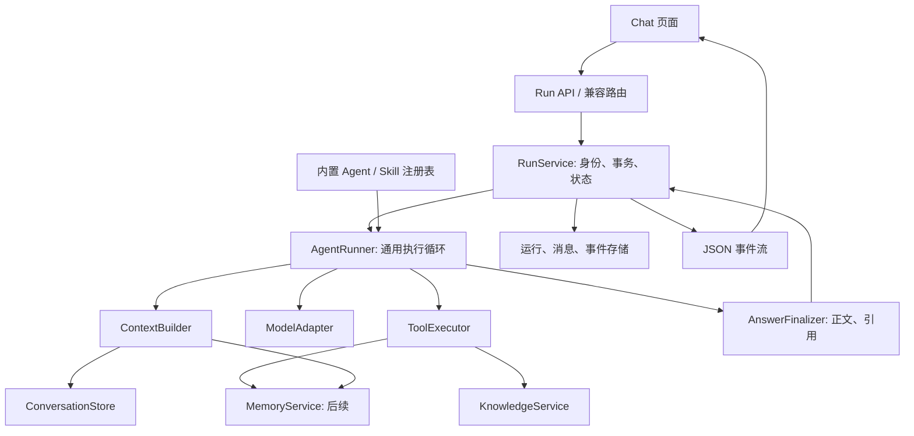

# FUE Agent 体系设计 v1

状态：实施前设计。日期：2026-10-21。基线：`09ae277`。

实现更新：现已接入内置资源加载、上下文构建、通用 Runner 和独立 Session 工具绑定；四个现有 Chat/RAG 接口均使用新链路。详见 [运行时说明](../../backend/agents/README.md)。本文件中的持久化 RunService、新事件协议、消息修订与长期记忆仍为目标设计，未随本次接入实现。

## 1. 核心决定

用一个通用执行器运行内置 Agent。Agent 的角色、Skill 组合、工具范围与执行预算使用声明文件描述；任务说明使用 Markdown Skill；工具实现、数据一致性与执行约束保留在 Python。普通聊天和知识库问答走同一条执行链。

首期只发布内置资源，不提供第三方代码加载、Skill 商店、用户脚本或多 Agent 协作。声明文件可以独立修改，但只能引用程序已经注册的能力。新增提示规则不需要修改路由；新增真实能力仍需开发工具与服务。

首期一个 `chat` Agent、一个 `knowledge-qa` Skill。普通聊天是 Agent 的基础行为，知识库问答是按场景激活的能力。后续写作场景可以使用另一个 Agent，共用执行器和领域服务。

## 2. 边界与依赖



| 模块 | 负责 | 不承担 |
| --- | --- | --- |
| AgentDefinition | 基础角色、可用 Skill、工具上限、上下文和输出策略 | 检索、数据库操作、网络调用 |
| SkillDefinition | 适用场景、任务步骤、证据使用、缺少证据时的行为 | 动态执行代码、越过工具范围 |
| SkillResolver | 根据明确场景与资源激活 Skill，产生可检查的解析结果 | 首期不让模型自由选择 Skill |
| ContextBuilder | 按有效历史版本、预算和来源类型构造模型输入 | 保存消息、执行工具 |
| AgentRunner | 模型/工具循环、预算、截止时间、取消、收敛 | SQL、HTTP、特定知识库查询 |
| ModelAdapter | 模型能力检查、文本/工具调用归一化、提供商兼容 | Agent 场景判断 |
| ToolExecutor | 名称分发、参数校验、范围校验、超时、结果规范化 | 由模型指定资源权限 |
| RunService / Store | 请求幂等、会话并发控制、事务、运行和事件记录 | 提示词与工具循环策略 |
| AnswerFinalizer | 引用解析、最终正文和 references 一致性 | 将模型生成的任意来源认作真实证据 |
| MemoryService（后续） | 记忆查询、修订、来源、失效与遗忘 | 控制 Agent 生命周期 |

依赖方向：API → 编排层 → 领域服务 → 存储/提供商。领域服务不得反向导入聊天路由。工具只接收运行上下文与服务接口，不持有 HTTP 请求 Session。

## 3. 资源与配置

建议目录（目标结构，尚未创建运行时模块）：

```text
backend/
  agents/
    definitions.py       # 严格声明类型与校验
    registry.py          # 内置资源加载及引用检查
    resolver.py          # Agent / Skill / 预算解析
    runner.py            # 单个通用循环
    context.py           # 上下文与预算
    model_adapter.py     # 包装现有 providers.chat
    tool_executor.py
    events.py
    finalizer.py
    resources/
      agents/chat.json
      prompts/chat.md
      skills/knowledge-qa/skill.json
      skills/knowledge-qa/SKILL.md
  runs/
    router.py
    service.py
    models.py
    repository.py
  tools/
    registry.py
    knowledge.py
  knowledge/service.py   # 从原工具闭包提取检索业务
  conversations/         # 保留，并增加修订及分支处理
  memory/                # 后续独立实现
```

可直接审阅的声明样例放在本目录的 `agent-examples/`，不是当前应用已经支持的格式。采用 JSON + Markdown，避免首期为配置引入 YAML 依赖。

规则：声明包含 `schema_version` 与资源版本；未知字段、重复 ID、失效引用、非法预算、未知工具全部拒绝。文件路径必须在随应用发布的资源目录内。启动时验证整套资源；无效新版本不静默替换为别的行为。生产环境随版本发布，开发环境修改后重启，不做热更新。

每次运行保存 Agent/Skill 声明、提示正文及其哈希的快照，并记录最终预算、实际模型配置与能力模式；配置快照排除密钥。这用于解释当时的行为，不保证远程模型输出可逐字重放。

## 4. Agent 与 Skill 如何组合

首期激活完全确定：未选择知识库 → `chat` 基础行为；选择知识库 → `chat` + `knowledge-qa`。Skill 条件来自应用传入并经服务端验证的资源范围，不由自然语言或文档中的“启用某 Skill”触发。

解析顺序：

1. 加载并验证 Agent 声明与关联资源。
2. 按场景选择其声明中已允许的 Skill。
3. 将 Agent 工具白名单、已激活 Skill 工具声明、应用支持能力和本次资源范围取交集。Skill 声明的必需工具不可用时，显式报错或采用已声明的降级策略。
4. 执行预算取应用硬上限、Agent 配置和已验证会话设置中的最小有效值；Skill 不能提高预算。
5. 固定顺序组装基础提示与 Skill 正文；首期只有一个可激活 Skill。未来多 Skill 组合须显式声明兼容关系与顺序，冲突时拒绝配置，不以提示词先后猜测优先级。

基础提示应短且稳定。Skill 说明应描述任务做法。会话、检索片段与记忆放在有来源标识的数据区，不拼入 Skill 正文；适配器按模型接口支持的角色承载。模型输入仍可能受不可信文本影响，因此工具范围与写入规则必须由服务端执行。

## 5. 运行流程

一次运行只产生一个最终回答；可以有多次模型调用和有上限的工具调用。知识库问答允许有限的补充检索，不再把“只能搜索一次”写死在 Python 或所有场景通用提示里。

```text
接受命令 → 幂等检查 / 会话版本校验
  → 事务：保存提问或引用已有提问 + 创建 run + 占用会话运行槽
  → 解析 Agent / Skill / 模型能力 / 资源范围并保存快照
  → 构建上下文
  → 模型调用
      → 工具调用：校验 → 执行 → 保存调用与证据 → 重建上下文 → 下一轮
      → 最终文本：校验与引用处理
  → 事务：保存最终回答、引用、完成状态和终态事件
  → 发布终态事件 → 释放运行槽
```

模型产生的工具名称必须精确匹配注册表；多个工具调用按返回顺序串行执行。未定义依赖与并行安全前不并发执行。参数错误返回结构化工具错误，是否再尝试受预算限制；重复的规范化调用不重复消耗外部检索，复用本次结果。

预算至少包括：模型调用次数、工具调用次数、单次工具超时、总运行截止时间、工具结果字符/Token 上限和模型输出预留。每次追加证据后重新计算上下文预算。达到工具预算后，若仍有模型调用预算则进行一次无工具收敛调用；该调用也计入模型上限，没有剩余预算则以 `budget_exhausted` 失败，不伪造成功。

提供商支持完整工具消息协议时保留工具调用与结果。遇到现有推理模型兼容问题时，由 ModelAdapter 使用声明的证据注入模式：工具运行后将结果转为证据块，随后无工具生成最终回答。能力不足时可声明为必做一次检索再合成回答，查询取当前提问；不能静默跳过知识库而给出看似有依据的回答。

取消在每个模型/工具边界检查。同步线程中的检索可能无法立即停止；取消后停止后续调用，丢弃晚到结果，不允许晚到回答把 cancelled 改成 completed。客户端断开只停止订阅，运行仍由服务端管理；用户“停止”按钮调用明确取消接口。应用进程重启后将遗留运行标记 failed/interrupted，首期不自动重新调用模型。

## 6. 工具与证据契约

首期只注册 `knowledge.search`，其 Python 实现复用现有向量、关键词、混合检索与重排能力。

```text
ToolContext:
  run_id, conversation_id, allowed_kb_ids, deadline, cancellation

knowledge.search args:
  query: 非空字符串
  mode: vector | keyword | hybrid
  top_k: 有界整数

ToolResult:
  call_id, tool_name, status: ok | empty | error
  evidence: [{evidence_id, source_type, source_id, source_revision,
              locator, excerpt, score, metadata}]
  error: {code, message, retryable} | null
  truncated: bool
```

模型不能通过 args 自行扩大知识库范围；`allowed_kb_ids` 来自应用选择并由服务端验证。`source_revision` 首期可用文档内容哈希/索引版本表达；现有数据不足时先生成稳定版本值，不能伪造修订号。

区分 `empty` 与检索故障。无证据时说明缺少依据，工具错误时说明检索失败；可以给出明确标识为一般知识的补充回答，但不得生成文献引用。重复来源复用 evidence_id；引用标记只允许关联本次验证过或有效历史版本关联的证据。未知引用不得进入最终引用表。

运行内部使用稳定 evidence_id，展示编号由 Finalizer 确定。首期兼容现有 `[CITE-N]` 与 references 格式，映射只在 Finalizer 内维护。最终正文、引用与事件必须由同一个 FinalAnswer 对象生成。

## 7. 状态与持久化

运行状态：`queued → running → completed | failed | cancelled`。终态不可逆。等待模型、执行工具、整理回答属于 progress 阶段，不增加一套易失同步的持久状态。

| 数据 | 核心字段 / 约束 |
| --- | --- |
| AgentRun | id、conversation_id、request_id、operation、source_user_message_id、context_revision、status、config_snapshot、model_snapshot、final_message_id、error_code、时间；conversation_id + request_id 唯一 |
| AgentToolCall | run_id、call_id、工具名、校验后参数、状态、证据、耗时；run_id + call_id 唯一；仅保存必要信息 |
| RunEvent | run_id、seq、type、payload；run_id + seq 唯一，可按序续读 |
| MessageRevision | message_id、revision、内容、有效状态、修订来源；保留旧版本用于回溯 |
| Conversation | context_revision、active_run_id；以数据库原子条件更新保证每会话仅一条可写运行 |

同一 request_id 重试返回原运行，不再追加消息；相同 ID 不同命令返回冲突。同会话新请求与当前运行冲突返回 409，前端明确显示；不同会话可以并行。保存事务和范围检查不依赖内存锁，SQLite 本地单进程部署也要保持可检验的并发约束。

首期编辑后重发采用“修订并使后续链路失效”，保留审计历史，不提供分支树 UI。`edit` 在事务内新建用户消息修订并作废后续有效消息；`regenerate` 复用原用户消息，旧回答保留为历史版本并从有效上下文移除。两者都不再次插入同一提问。必须携带 expected_context_revision，过期页面返回 409。

失败与取消保存已接收文本为 partial draft，明确标记不完整，不进入后续有效历史，也不提炼长期记忆。完成事务失败不能发送 completed；若数据库不可写且无法保存 failed，向在线客户端返回 transport error，数据库恢复后由启动/恢复检查处理未终结 run。

历史导入采用增量迁移：旧消息先作为 revision=1 保留原 ID，旧 references 继续读取。新增数据使用迁移版本表管理；迁移前备份数据库，失败回滚；不要以启动时散落的 ALTER TABLE 长期扩展体系。

## 8. API 与前端

目标 API：

```text
POST /api/conversations/{id}/runs
  {request_id, agent_id: "chat", operation: "send" | "edit" | "regenerate",
   expected_context_revision, content?, source_message_id?, model_id,
   resources: {kb_ids: []}, stream: true | false}
  → 201 {run_id, status, events_url}；幂等命中返回 200

GET  /api/runs/{run_id}               # 状态、最终结果或部分内容
GET  /api/runs/{run_id}/events?after_seq=N
POST /api/runs/{run_id}/cancel        # 幂等取消
```

创建接口只启动同一后台运行；stream 控制客户端消费方式，不改变生成和存储路径。非流式客户端轮询 run 状态，流式客户端订阅事件。SSE 数据使用 JSON，例：

```json
{"run_id":"r-123","seq":8,"type":"text.delta","payload":{"text":"第一行\n第二行"}}
```

事件：`run.started`、`skill.activated`、`progress`、`tool.started`、`tool.finished`、`text.delta`、`answer.final`、`run.completed`、`run.failed`、`run.cancelled`。text.delta 仅流式传递候选答案，不发送隐含推理过程；工具规划阶段的文本不作为最终回答展示。answer.final 是经过引用处理的权威正文，客户端替换临时内容。

终态事件与消息同事务保存后才能发布。事件发布失败可从存储重放；不能把 EOF 解释为成功。客户端按 run_id + seq 去重，重连从最后 seq 继续。分段聚合后持久化文本事件以减少 SQLite 写入；慢客户端不阻塞生成，重连读取持久事件。首期保留事件至用户删除会话，后续再增加清理策略。

前端传当前命令与资源选择，服务端从数据库构造历史。前端不再重传全量历史，不编写知识库 system prompt，不通过内容或消息位置猜测保存是否成功。界面展示本轮 Agent、已用 Skill 和检索状态即可，首期不增加配置编辑器。

旧 `/api/chat/{model_id}` 系列端点在迁移期作为适配入口，调用同一 RunService；旧事件由兼容层转换，不保留第二套工具循环。无 conversation_id 的原接口保留为不持久化临时运行。前端完成切换后再移除兼容层。

## 9. 上下文与长期记忆接点

ContextBuilder 首期统一处理：基础指令、激活 Skill、有效历史、当前提问、检索证据。预算先预留输出和工具空间，再分配历史与证据。保留当前完整提问和最近完整轮次；超额时优先去重/缩短证据、使用有效滚动摘要；仍无法容纳时返回明确错误，不静默截断当前提问。

滚动摘要必须标注覆盖到的消息版本，仅用于当前会话连续性。长期记忆在后续作为可替换 MemoryProvider 接口接入，默认实现返回空结果，不预先创建空的复杂记忆子系统。

后续长期记忆读取由 ContextBuilder 按已确认的作用域与开关检索；用户明确要求深挖旧对话时，才由新 Skill 使用 `conversation.search` 或 `memory.search` 工具。自动记忆写入通过运行完成后的派生任务执行，不把模型任意文本直接作为长期事实。来源包括消息修订与 run_id，编辑/删除会发出失效事件；派生任务使用独立 Session 和来源版本检查。

首期不启用长期记忆写入工具，避免 Agent 拆分与记忆策略同时改变。Writing 的文稿编辑仍由独立文档服务负责，未来 Agent 只能生成可审阅的修改建议，具体写入规则另行设计。

## 10. 分阶段迁移与验收

| 阶段 | 交付 | 验收 |
| --- | --- | --- |
| A：声明与领域服务 | 严格配置类型、资源加载、样例 Agent/Skill、独立知识检索服务 | 修改 Skill 文本无需改 Python；坏配置明确失败；检索结果与当前一致 |
| B：运行身份与存储 | RunService、请求幂等、状态、会话版本、消息修订 | 重试/编辑/重生成不重复提问；同会话冲突可见；失败不假报成功 |
| C：通用执行链 | ContextBuilder、Runner、ToolExecutor、Adapter、Finalizer；旧路由转接 | 普通/RAG 与流式/非流式共用执行逻辑；所有结束路径正文与引用一致 |
| D：前端协议 | run API、JSON 事件、显式取消、续读与状态恢复 | 换行不丢；重连不重复；切换会话不串消息；EOF 不当完成 |
| E：长期记忆 | 单独设计并实现对话索引、记忆条目与管理入口 | 来源可回溯；作用域明确；修订/删除导致派生数据失效 |

必需测试围绕行为边界：配置引用与工具白名单、幂等与并发、工具异常/空结果/预算耗尽、取消后晚到结果、事务失败、事件断线续读、检索证据超预算、引用有效性、旧数据迁移。用假模型与假工具覆盖执行状态，再少量验证真实提供商兼容性。

实施完成的判断：router 内不再存在 RAG 工具循环和角色提示；普通聊天也经过 Runner；Skill 中无数据一致性规则的唯一实现；所有模型调用都有预算、身份与可终结状态。保留现有 providers、知识库和引用展示能力，分阶段替换。

## 11. 本次交付边界

本文件及 agent-examples 是体系设计与可审阅样例，尚未实现加载器、执行器、数据库迁移或 UI。样例中的版本号、预算是起始建议，实施时结合现有设置确定有效值；不代表当前运行行为已改变。
