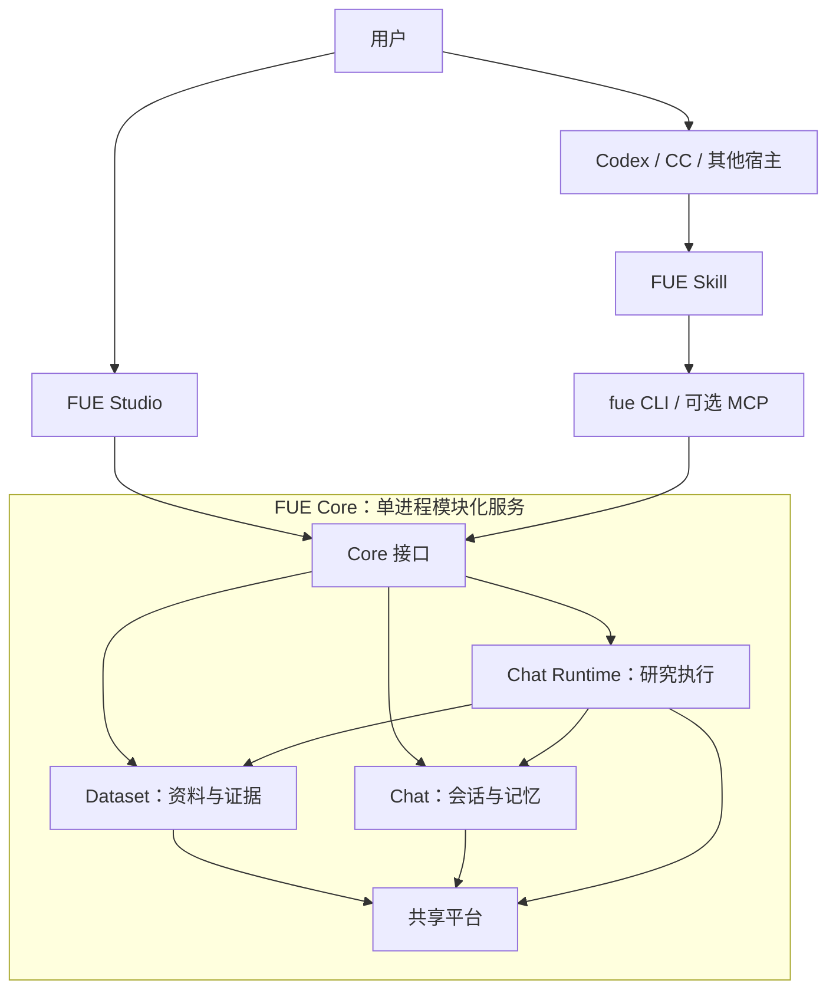

# FUE 2.0 架构与拆分决策

日期：2026-10-21  
状态：讨论后的目标架构，尚未实施；本次仅更新文档。  
代码基线：`c85e51f8bcab973afeeb30a6633d62af34acddc2`（当前正式版 1.0.11）。  
来源：原《FUE 新架构设计 v2》及后续讨论。本文件作为仓库内的后续实施依据；与原提案冲突的范围和生命周期约定，以本文件为准。这里的 2.0 指产品重构，不是已有“长对话工作记忆 v2”功能的版本号。

## 1. 本轮确定的方向

FUE 拆分为 Core、Studio、Skill 三个组件，继续在一个仓库中开发。Core 首期采用单进程模块化结构，复用 FastAPI、SQLAlchemy、SQLite、Chroma 及现有业务能力。

本轮目标是让已有的文献处理、检索、聊天记忆和研究执行能力可以被不同入口使用。

| 决策 | 本轮约定 |
| --- | --- |
| 产品组件 | Core 提供能力，Studio 提供界面，Skill 接入外部 Agent |
| 数据与记忆 | FUE 自有记录可供宿主查询；不反向导入或同步宿主聊天历史与记忆 |
| 研究执行 | FUE 自己执行的研究由 FUE 管理；宿主执行的研究由宿主管理 |
| 上下文 | FUE 只管理自身模型调用的上下文和预算 |
| 资料清洗 | FUE 内部能力，通过接口提供处理结果和来源 |
| Write | 下个大版本目标，本轮不开发共享文稿、写作接口或协作编辑 |
| Core 生命周期 | 默认随 Studio；Agent 可自动连接、按配置启动；空闲五分钟回收；可选常驻 |
| 身份 | 区分 Studio 与 Agent，服务共享同一数据实例 |
| 宿主适配 | 保证 FUE 接口可用即可，不要求宿主具有与 FUE 一致的数据管理体验 |

“记忆单向提供”约束的是宿主历史和记忆同步，不阻止宿主提交明确的 FUE 研究任务。任务及其在 FUE 内产生的执行记录属于 FUE 数据，不能据此自动吸收宿主会话。

## 2. 总体结构



外部宿主读取 FUE 的资料、记忆和任务结果；其自身上下文、记忆及内部执行过程由宿主管理。图中的调用关系不表示双方同步聊天数据库。

CLI 是轻量客户端，不作为第四个产品。API、CLI、MCP 使用同一组应用服务，避免维护多份检索实现。

## 3. Core 的职责

### 3.1 Dataset：资料、处理与证据

负责知识库和文献目录、文件导入、解析、清洗、书目识别、索引、检索、相邻内容阅读及引文格式化。

```text
原始文件 → 原始提取文本 → 可选清洗产物 → 分块与索引 → 检索、阅读、引用
                    └→ 书目提取与人工修正
```

原始内容与清洗产物分别保存。返回内容应说明来自哪种文本及哪个版本；逐字引述能够回到原始来源核对。未知书目字段、无法可靠定位的 PDF 页码和坐标保持为空。

清洗、嵌入和重排可调用 FUE 配置的模型。Dataset 不依赖 Chat 的会话或主模型循环。宿主如何处理拿到的资料不属于 Dataset 的职责。

知识库支持关键词检索，以及含语义检索的 RAG 模式。关闭语义检索时，关键词检索仍可用。索引未就绪、空结果和模型失败应分别报告。

### 3.2 Chat：会话与记忆

保留既有记忆设计，拆分时保持其数据与删除语义：

- 原始消息与问答对是完整记录；摘要不能替代原文。
- 聊天检索以问答对为单位，支持内容、时间和上下文查询。
- 历史访问范围包括禁止查询、7 天、30 天、360 天、所有历史。
- 聊天也区分关键词模式和含语义检索的模式；禁止历史查询时，两种检索都关闭。
- 每个会话有受长度限制的 `summary.md`；数据库保存摘要权威记录，文件作为可检查的投影。
- 已处理材料可从当前模型上下文中移除或以处理结果代替，原始日志继续保留。
- 压缩产生明确事件与引用标记，并在后续模型上下文中说明；模型可通过工具回读原始问答和压缩对应范围。
- 用户删除记录时同步清理相关索引、摘要和派生记忆，不保留可继续查询的删除正文。

Chat 向外提供 FUE 历史的只读搜索和回读能力，沿用来源权限与时间范围。宿主自己的会话和记忆不进入该链路。

文献和聊天拥有相似的“搜索—读取—上下文”接口，但分别由 Dataset、Chat 的来源适配器实现。Dataset 不直接读取聊天表。

### 3.3 Chat Runtime：FUE 自身的研究执行

普通聊天与独立研究任务共用执行基础。独立任务可不创建 Studio 会话，使用明确的目标、资料范围、模型配置和执行预算。

FUE 负责其内部的上下文选择、摘要压缩、工具调用、超时、取消、过程事件及结果保存。过程记录包含实际工具操作、读取来源、阶段和用量，不要求保存模型内部思维链。

外部 Agent 可以提交一个明确任务并读取结果。FUE 不观察、复原或接管 Codex、CC 等宿主的内部研究过程。

任务结果包含回答或研究结论、来源映射、实际阅读范围、未解决问题、终止原因及可获得的用量。任务记录由 FUE 管理；本轮不额外建立跨宿主研究记忆系统，也不自动将全部任务过程索引为聊天问答。

首期沿用单 Runtime 与不同任务配置，不增加递归 worker 调度。

### 3.4 共享平台

负责模型供应商适配、配置、凭据、用量记录、任务基础设施、运行日志和 Core 生命周期。

```text
Chat / Runtime → Dataset → Platform
Chat / Runtime → Platform
Transport → 应用服务 → 领域能力 → 存储和模型适配
```

预算估算等通用能力放在共享层，避免共享平台反向依赖聊天记忆模块。模型配置可按用途延迟加载。Dataset 可以独立工作；是否进一步制作不包含 Chat 依赖的精简安装包，不作为首个交付的前置条件。

## 4. Studio 与 Skill

### 4.1 Studio

继续演进现有 Electron、React、TypeScript 界面，负责文献管理、聊天研究、记忆检查、来源审阅、模型设置和运行状态展示。

Studio 通过 Core 应用接口访问业务数据。Electron 保留窗口、文件选择、系统打开、Core 启动和桌面生命周期能力。

Write 原型暂留现状。本轮不迁移文稿存储，不增加 Workspace Documents 服务、共享编辑、成稿导出或写作专用 API。已有研究回答与任务结果的保存仍属于 Chat/Runtime。

### 4.2 Skill

Skill 提供安装连接说明、命令使用和任务路由，默认通过 CLI 使用 Core，MCP 可作为同一能力的另一入口。

| 模式 | FUE 提供什么 | 谁负责后续推理和上下文 |
| --- | --- | --- |
| Direct，默认 | 目录、搜索、原文与相邻内容、引文、获准的 FUE 记忆 | 外部宿主 |
| Delegated | 在 FUE 内执行完整研究任务，提供进度与结果 | FUE 管理任务内部；宿主管理收到结果后的行为 |

Direct 的嵌入、重排仍可能产生 FUE 模型费用。Delegated 会调用 FUE 的研究模型，按照明确任务配置执行；查询失败不自动升级为委托研究。

Skill 不上传宿主完整聊天记录，不同步宿主记忆，不修改宿主全局模型、提示词或上下文策略。只需验证能够连接和调用 FUE；不要求各宿主提供相同界面、内部日志或数据管理行为。

## 5. Core 生命周期与双身份

### 5.1 默认启动方式

Core 随 Studio 分发和启动。Studio 优先连接同一数据目录的已有 Core，避免重复启动。Agent 自动发现并连接该实例；配置允许时，可调用已安装 Core 的启动入口，无需打开 Studio 窗口。

自动连接不自动创建空知识库或新的数据目录。尚未安装、未完成初始化或找不到指定实例时，返回明确状态。`status` 和 `doctor` 保持只读。

### 5.2 Studio 与 Agent 身份

| 身份 | 生命周期作用 |
| --- | --- |
| Studio | 有效连接持有 Core；Studio 在使用时不因 Agent 空闲而退出 |
| Agent | 有效业务请求更新 Agent 活动时间；断开或结束调用不立即关闭 Core |

身份由连接注册与认证确定，不允许请求任意声称自己是 Studio 来永久保活。身份区分用于生命周期和必要的能力范围，不引入多租户账户体系。

Studio 正常退出时释放持有；异常退出通过本地进程状态或有期限的连接租约识别，不能让残留记录永久阻止回收。

### 5.3 五分钟回收规则

Core 仅在以下条件同时满足时自动退出：

1. 后台常驻设置关闭。
2. 没有有效的 Studio 持有。
3. 没有已接受且等待执行的任务，也没有正在执行的业务请求或任务。
4. 距离最近有效 Agent 业务活动，或最近一次任务完成、Studio 释放持有，已连续空闲至少 300 秒。

这里把“超过五分钟没有反馈”落实为可由 Core 判断的空闲状态。慢模型、长时间清洗和研究任务不算空闲；普通健康检查、轮询状态不反复延长空闲期限。任务完成后从新的空闲时刻计时。

退出前停止接收新任务，完成必要状态落盘并清理服务发现记录。进入退出过程时遇到新连接，客户端可重新发现或启动实例，不能重复提交已经接受的研究任务。

### 5.4 可选后台常驻

用户可设置 `keep_alive=true` 关闭空闲回收。默认关闭；本轮不要求安装系统服务或开机自启。

Studio 关闭后，若仍有任务，Core 继续执行；若有 Agent 活动，按空闲规则继续运行；常驻模式下持续运行。一个 Core 实例独占一个数据目录，两个身份共享服务和资料。

## 6. 接口与数据约定

以下是目标接口示例，尚未实现。

| 接口领域 | 示例 CLI | 用途 |
| --- | --- | --- |
| 连接 | `fue status --json`、`fue doctor --json` | 实例身份、连接、版本和能力 |
| 生命周期 | `fue core start`、`fue core stop` | 显式启动或停止 |
| 目录 | `fue libraries list`、`fue papers list` | 列出获准的资料 |
| 文献阅读 | `fue search`、`fue read`、`fue cite` | 检索、相邻正文、格式化引文 |
| FUE 记忆 | `fue memory search`、`fue memory read` | 查询 FUE 历史；不提供宿主历史导入 |
| 处理任务 | `fue jobs get` | 导入、清洗和索引状态 |
| 研究任务 | `fue tasks submit/get/cancel` | 委托 FUE 执行、查询或取消 |

HTTP 按 `system`、`dataset`、`chat`、`jobs`、`tasks` 组织；本轮不增加 `workspace`。外部记忆工具默认只读，Studio 自身的会话编辑继续使用 Chat 服务。

接口提供稳定 ID、来源类型、可用版本、正文或预览、截断状态、分页入口和明确错误。搜索默认给有限预览，阅读支持按需扩展；这是 FUE 的接口输出规则，不承诺控制宿主的上下文装载方式。

CLI 的 JSON 结果写 stdout，运行日志写 stderr；大任务输入采用文件或 stdin。空结果、来源失效、索引未就绪、模型失败和连接失败分别表示。

任务状态使用 `queued / running / succeeded / partial / failed / cancelled / interrupted`。FUE 事件记录序号，支持按序查询；Studio 可展示阶段和工具活动，外部宿主自行决定如何呈现。

模型实际用量、程序估算值和金额估算分别标识。预算仅约束 FUE 发起的模型调用，不包含宿主自己的消耗。

### 6.1 证据身份

文献 ID、文本版本、索引版本、证据 ID 和回答内的 `[1]` 分开。最低限度的稳定来源身份及失效规则在首条外部阅读链路中建立，完整多版本处理可后续补齐。

重建索引后，旧证据不得静默指向不同文本。已有来源能够解析则返回原来源；已删除或无法解析则明确失效。此规则只约束 FUE 返回的数据，不要求宿主建立对应的版本管理系统。

### 6.2 本地存储

SQLite 保存文献、书目、会话、问答、摘要、事件与任务等权威记录；Chroma 保存可重建的文献和聊天检索索引；文件目录保存原始文件、处理产物和摘要投影。文献与聊天索引分开管理。

不为组件拆分新建平行数据库。保留已有数据目录和 ID 映射，迁移目录布局时先验证数据副本。跨 SQLite、Chroma、文件的更新采用持久任务和可重试清理，不能假设三者具有同一事务。

访问默认限于本机，保留认证及来源范围检查；客户端身份和传入的库 ID 都不能绕过服务端权限。凭据不进入对外记录。

## 7. 建议仓库结构

```text
fue/
├─ fue-core/
│  ├─ pyproject.toml
│  ├─ src/fue_core/
│  │  ├─ dataset/          文献处理、检索、证据与引文
│  │  ├─ chat/
│  │  │  ├─ conversations/
│  │  │  ├─ memory/
│  │  │  └─ runtime/
│  │  ├─ platform/         配置、模型、任务基础和生命周期
│  │  ├─ transport/        HTTP / MCP 适配与来源路由
│  │  └─ cli/
│  └─ tests/
├─ fue-studio/             现有 frontend 演进
├─ fue-skill/
│  ├─ SKILL.md
│  ├─ references/
│  └─ scripts/
├─ contracts/
└─ docs/
```

这是目标布局，先解除业务依赖，再迁移路径和打包。首个发布采用 Studio 附带 Core，加可单独安装的 Skill/CLI 接入包；精简 Core 的独立发行不是当前拆分的必要条件。

## 8. 实施顺序

| 阶段 | 交付内容 | 验收重点 |
| --- | --- | --- |
| A：基线与边界 | 固定基线、备份，定义来源和读取契约，梳理模块依赖 | 当前数据和既有测试可复现；最小证据身份明确 |
| B：Core 与生命周期 | 抽应用服务，Studio 接入；实例发现、双身份、五分钟回收与常驻设置 | 同一数据实例；Studio 持有和长任务不被误杀；真正空闲可退出 |
| C：Direct 接入 | CLI/Skill 的目录、检索、相邻阅读、引文和 FUE 记忆只读查询 | 宿主能使用已有资料；不上传或同步宿主聊天 |
| D：FUE 内部处理整理 | 导入、清洗、书目、索引任务与版本状态统一 | 原始与清洗产物可区分；失败可追踪；旧证据不被错误重定向 |
| E：研究委托 | 执行器脱离 Studio 会话，提供任务、事件、预算、取消与结果 | 研究在 FUE 内执行并记录；不依赖宿主过程透明度 |

各阶段保持可运行版本，旧接口通过适配调用同一应用服务。保留现有聊天、问答记忆、压缩与删除行为；不长期双写两套权威数据。模型研究任务重启后，未具备可靠恢复能力时标记 `interrupted`，不自动重复付费执行。

首个可交付范围为 A—C：Studio 与外部 Agent 共享 FUE 已有能力，并具有明确的生命周期。文献处理与清洗沿用现有实现，在 D 阶段进一步整理；完整 Delegated 能力在 E 阶段开放。

## 9. 验收与范围收口

- Studio 和 Agent 连接同一实例，看到相同的获准资料。
- 外部 Agent 可读取 FUE 的历史及上下文，时间范围和删除限制有效。
- 不自动收集宿主消息、记忆、内部执行日志或完整上下文。
- Studio 存活时 Core 不被 Agent 空闲计时关闭；Studio 异常退出不会永久保活。
- Agent 使用结束且无任务后，连续空闲五分钟退出；健康轮询不阻止回收。
- 长任务、已接受的排队任务阻止空闲回收；常驻模式关闭回收。
- Core 重启仍使用原数据，发现信息不会让客户端误连空库。
- FUE 的清洗、上下文管理、调用预算及进度展示在自身执行链路中生效。
- 本轮不交付 Write、共享文稿、多租户、宿主记忆同步或宿主内部过程管理。

## 10. 相比原提案的调整记录

1. 明确记忆仅由 FUE 向宿主提供，删除跨宿主记忆治理的扩展方向。
2. 明确 FUE 研究记录只覆盖自身执行，不以宿主内部过程可见为条件。
3. 上下文、成本和清洗优化限定在 FUE 内；宿主自行决定如何消费返回内容。
4. Write、Workspace Documents、文稿并发修改和写作导出移至下个大版本。
5. Core 默认随 Studio，增加 Studio/Agent 双身份、五分钟空闲回收及可选后台常驻。
6. 首期聚焦现有 Core 的接入，不同时要求三种独立安装产品或严格宿主体验兼容。
7. 最小稳定证据身份提前到 Direct 接入之前，完整处理版本系统继续渐进实施。

相关现状文档：[聊天记忆与 MCP](conversation-memory.md)、[长对话工作记忆设计](working-context.md)、[已有记忆实现验证](../validation/working-context-2026-10-21.md)。这些文档描述 1.0.11 的现状与局部设计；本文件定义产品 2.0 的拆分目标，不表示新接口或生命周期已经上线。
