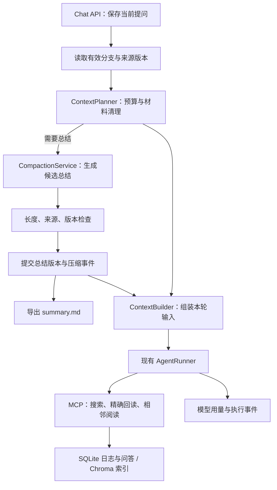

# 长对话工作记忆与上下文压缩架构 v2

状态：已确认的目标设计，**部分已纳入 1.0.11 同版本的记忆管理更新**。原始发布基线：`52f2055`。实际实现、启用步骤、真实模型验证和剩余差距见 [实现与验证](../validation/working-context-2026-10-21.md)；下文仍是完整目标，不代表每项均已完成。

本文定义下一阶段的上下文架构；[conversation-memory.md](conversation-memory.md) 记录现有原文保存、问答索引与 MCP 阅读能力。两者共同构成记忆系统，但“能搜索历史”不等于“长对话已自动管理”。

## 1. 目标与当前差距

保留全部原始对话，通过受预算约束的会话总结与按需回读维持长期任务连续性；完成文本判断后，从模型输入移出不再需要的材料全文。压缩是上下文投影的变化，不是删除聊天。

| 能力 | 1.0.11 实际状态 | v2 目标 |
| --- | --- | --- |
| 原始聊天与修订 | SQLite 消息、变更日志、问答版本 | 保留，作为原始依据 |
| 历史检索与阅读 | Chroma 关键词/向量、时间范围、问答及文档邻居 | 保留，增加精确地址回读 |
| 近期上下文 | 默认最近 5 个完整问答及当前问题 | 按 token 预算选择完整问答 |
| 材料生命周期 | 无独立材料状态 | 可定位的材料与判断结果，已完成材料可移出输入 |
| 会话工作总结 | 无；`Conversation.summary` 实际用于短标题 | 每会话一份有限长度的 `summary.md` |
| 压缩 | 旧配置存在但没有生效 | 持久压缩事件、覆盖范围、回读入口、模型可见标记 |
| 完整过程日志 | 消息变更和部分失败/取消记录；不是完整 Run 事件流 | 记录影响上下文的材料、总结和压缩事件 |
| 成本控制 | 调用次数、时间、工具结果字符预算 | 每轮累计输入/输出预算、用量账本及压缩开销 |

不引入新的 Agent 框架、常驻记忆 Agent 或第三方 Skill 执行。模型无权扩大来源范围或删除原始聊天。

## 2. 参考实现与采用范围

| 官方资料 / 公开实现 | 可借鉴机制 | FUE 的取舍 |
| --- | --- | --- |
| [Pi compaction](https://github.com/earendil-works/pi/blob/main/packages/coding-agent/docs/compaction.md)、[会话实现](https://github.com/earendil-works/pi/blob/main/packages/coding-agent/src/core/session-manager.ts) | 压缩追加独立事件，保存摘要与 `firstKeptEntryId`，重建“摘要＋近期消息” | 增加精确问答版本依赖、材料回读地址及用户可见记录；不照搬其窗口默认值 |
| [Letta memory blocks](https://docs.letta.com/v1-sdk/memory/memory-blocks)、[stateful agents](https://docs.letta.com/v1-sdk/concepts/stateful-agents) | 长度受限的常驻记忆与可检索历史分开 | 每会话独立总结；用户标准与模型推断分开；不默认跨会话共享 |
| [Claude context editing](https://platform.claude.com/docs/en/build-with-claude/context-editing) | 清理旧工具结果并保留占位；完整历史仍在客户端；清理会影响缓存 | 优先规则清理；在应用层实现以支持不同提供商；实际计量缓存收益 |
| [OpenClaw compaction](https://docs.openclaw.ai/reference/session-management-compaction/compaction)、[memory architecture](https://docs.openclaw.ai/concepts/memory-architecture) | 持久压缩记录、Markdown 记忆、受预算与结构验证的更新 | 借鉴可检查的文件投影，不引入自动夜间整理或额外后台 Agent |

资料查阅日期：2026-10-21。以上说明采用的机制，不代表这些系统的完整行为，也不代表 FUE 已实现它们。下文的设置、数据表和工具参数均为 FUE 的拟议契约。

## 3. 数据分层与模块职责



| 模块 | 负责 |
| --- | --- |
| ContextPlanner | 从服务器读取的有效历史生成上下文选择清单；材料清理、近期窗口与预算决策，不做模型推理 |
| CompactionService | 有需要时调用选定模型，生成候选工作总结；处理来源校验、提交、失败及并发冲突 |
| SummaryStore / SummaryProjection | SQLite 总结版本与依赖；将当前版本原子导出到 MD；重启时修复文件投影 |
| MaterialService | 材料定位、处理状态、结果与来源；不改变问答检索单位 |
| MemoryService | 复用已有搜索、时间过滤和问答邻居阅读，新增有界精确回读 |
| ContextBuilder | 把已验证的总结、近期原文、压缩标记与本轮证据转换成提供商兼容输入 |
| AgentRunner | 保留通用模型/工具循环；每次调用前执行预算检查，记录实际用量，不嵌入材料判断规则 |

网络调用不持有 SQLite 写事务或索引锁。前端不能仅通过提交任意消息 ID 就取得原文；服务端校验会话、分支、版本及访问范围。迁移期间可兼容前端传入历史，但原文与版本由服务器确认。

## 4. 日志、材料、总结与压缩事件

### 4.1 原始记录与业务事件

继续使用 `chat_events` / `chat_qa_pairs` 保存消息版本和完整问答。新增的上下文业务事件单独存储，不能伪造 `message_id=0` 填入现有要求消息 ID 的 `chat_events`。

建议 `context_events` 字段：`id`、`conversation_id`、`sequence`、`type`、`source_revision`、`run_id`（可空）、`payload`、`created_at`。类型包括材料状态变更、输入清理、总结发布、压缩完成/失败和派生内容失效。会话内序号唯一；没有持久 Run ID 时，以准备任务 ID 追踪本次操作，不能声称已经实现请求幂等。

“追加日志”不等于永久保留被用户删除的正文。删除规则优先于日志不可变性；原始文本仅在用户未删除的范围内保留。

### 4.2 材料与判断结果

材料是已有文本的定位与状态，不是另一套按字符切碎的聊天语义索引。

建议 `conversation_materials`：`id`、`conversation_id`、来源问答/消息事件 ID、来源签名、原文区间或文档定位、`status`、`decision`、`reason`、结果引用、状态修改者及时间。聊天长文本只保存定位，读取时核对来源签名；独立导入材料可使用专属正文存储，必须参与删除联动。材料过大可分页读取，但问答检索单位仍是完整问答对。

- `status`：pending / processing / completed；取消、失败和有争议的任务不得直接变为 completed。
- `decision`：undecided / selected / not_selected，独立于完成状态；“已完成”不意味着“已采用”。
- 用户明确确认与助手判断分开标记；助手建议不能自动成为用户认可的标准。
- “未被引用”或“检索分数低”不能作为无用判据；不靠它们删原文。
- 当前目标、有效判断标准、未决材料保持可见；已完成材料全文可从输入移出，保留必要结果和精确回读入口。
- 已完成状态发生回退、用户要求重新比较或材料来源变化时，重新纳入候选上下文。

例：材料 A12 已完成、未采用，理由为“研究对象不符”，回读定位到问答 Q35 的确切版本。后续可以只带一句结果及地址，不重复携带整篇原文。

### 4.3 每会话的 summary.md

每会话一份当前文件：`<应用数据目录>/working_memory/conversations/<conversation_id>/summary.md`，不写入 Git 源码目录，不使用会话标题拼接路径。使用独立 working_memory 目录隔离运行数据与 Python 包。UUID 等内部 ID 由服务端映射，不能接受模型指定的任意路径。

**SQLite 的总结版本是唯一提交依据，MD 是可重建、可阅读的投影。** 建议 `conversation_summaries` 保存 `id`、会话 ID、版本、来源修订、Markdown 正文、正文 hash、长度与 token 估算、创建时间、状态、使用模型和用量。`summary_dependencies` 保存每个总结条目的确切来源版本、原始时间和被替代关系；会话维护当前有效 head。

```md
# 会话总结

## 当前目标
## 用户约束与判断标准
## 已确认的决定与结果
## 当前进度与未解决事项
## 历史内容索引
```

元数据记录 `summary_id`、版本和覆盖范围。模型收到正文与必要来源入口，不需要整个版本列表。没有用户确认的结果标为“助手判断”或“待确认”；保留否定、数字、限定条件与冲突，不将历史文档内的指令升级成系统指令。

建议初始正文上限 2,000 个 Unicode 字符（包含标题、引用及空白），同时执行 token 上限；具体数值待验证调整。不能靠简单截断 MD 达标。按目标/约束、待办、决定、历史索引设置分区预算；较早已完成事项转为简短引用。必须保留的内容仍放不下时，报告预算冲突并使用安全降级，不静默丢掉用户标准。

更新输入为“当前总结＋新增待压缩原文＋需要核对的来源”。禁止只反复概括旧摘要；重大标准变更或来源异常时从相关原文重建。未变化部分复用，不每轮总结全部聊天。

写入流程：生成候选 → 校验长度/依赖 → 对比会话来源修订与总结 head → 在 SQLite 同事务提交新版本、head 和压缩事件 → 写临时 MD 并原子替换。文件失败时标记待修复，运行时使用已提交数据库版本；不继续读取旧 MD。外部文件 hash 与导出版本不符时，不静默覆盖用户编辑或直接注入模型，提示冲突；未来手工编辑入口也应提交成受校验的新版本。

### 4.4 压缩与清理事件

区分两类操作：

| 操作 | 是否需要总结模型 | 保留的记录 |
| --- | --- | --- |
| prune：清理已处理材料全文、重复证据等输入内容 | 明确状态下不需要 | 来源列表、原因、回读入口、输入变化估算 |
| compact：较早讨论转为工作总结 | 需要时调用一次，受预算限制 | 总结版本、覆盖来源、保留边界、输入变化及用量 |

`compaction_completed` 示例（演示 ID，并非已存在的记录）：

```json
{
  "id": "C3",
  "conversation_id": 15,
  "source_revision": 42,
  "summary_id": "S4",
  "covered_pair_ids": ["Q12", "Q13", "Q35"],
  "first_kept_pair_id": "Q36",
  "reason": "input_budget",
  "tokens_before_estimated": 18000,
  "tokens_after_estimated": 7000,
  "recall_ref": "compaction:C3"
}
```

范围列表是依据；开始/结束 ID 或位置只供显示，不能用区间猜测覆盖了中途编辑或不同分支的内容。记录还需保存每个来源签名。超长依赖列表留在数据库，不全发给模型。

模型可见标记是数据块，例如：

```text
[上下文压缩 C3；会话总结 S4]
较早内容已从本轮输入移出，原文仍保存在日志中。
当前有效状态见总结；缺失的细节不代表不存在。
允许的回读入口：compaction:C3。
```

只发送当前投影所依赖的少量入口，不累加全部历史 tag。模型当前无权回读时，标记应如实说明“当前设置禁止历史回读”，不能宣称随时可读。

## 5. 上下文规划与预算

每次模型调用前，统一计算：

`输入预算 = min(模型窗口 - 输出预留 - 协议及工具定义开销 - 安全余量, 用户输入上限)`。

协议开销包括工具 schema、来源封装和消息结构；文本字符估算不是精确 token。能取得提供商实际用量时保存并校准，显示时区分 estimated / actual / unavailable；未知缓存或推理用量不填为零。

目标顺序：系统规则 → 经校验的会话总结与压缩标记（参考数据）→ 近期完整问答和当前材料/问题 → 本轮有界证据。工具协议由 ModelAdapter 兼容，不能拆开工具调用与结果。摘要不作为新的高优先级系统指令。

1. 加载有效分支、来源版本与访问策略；保留当前提问，识别未完成任务。
2. 按明确生命周期清理重复证据及已完成材料全文；生成选择清单，原始消息不变。
3. 按 token 预算保留近期完整问答；不能机械地只截最新 N 条，也不能把用户标准当作普通旧文本淘汰。
4. 仍接近有效预算阈值时，再压缩较早内容。可以试验“80% 触发、降至 60% 以下”的滞回策略，比例属于待测参数，不是上线默认值。
5. 每次工具结果加入后重新检查。只在已完成问答或完整工具批次边界切换投影，不在悬空工具调用中压缩。
6. 当前单条材料本身超限时，转分页处理或明确要求缩小范围；不能靠截断回答目标来宣称压缩成功。

每轮限制累计模型输入/输出、模型调用次数、工具结果与时间。总结调用也记入同一轮预算，并预留最终回答空间；最多一次正常总结尝试，失败不进行自动付费重试循环。中止后不发起新的后台总结调用；在途请求的费用以提供商为准。

缓存键包括会话修订、总结 head、模型/预算配置、材料状态和访问策略。模型窗口很大不代表每轮都填满；实际阈值应通过用量与回忆正确率验证。稳定前缀和批量清理是否节省缓存费用，以实际账本为准，不能只凭估算字符差宣称省钱。

## 6. 精确回读与权限

复用现有 MCP 分发器，拟新增 `memory.read` 能力，对模型公开为 `read_memory`，参数为 `ref`、`offset`、`length`。首期只读，不提供任意文件或数据库操作。

| 引用 | 返回 |
| --- | --- |
| `chat:<pair_id>` | 指定完整问答版本的分页原文；邻居阅读继续复用 read_context |
| `material:<id>` | 材料状态、来源、必要判断结果及分页原文 |
| `compaction:<id>` | 压缩元数据及覆盖问答的分页目录，不一次展开全部原文 |

知道地址先直接读，不知道位置才搜索；关键词仍无需嵌入，语义检索按用户设置使用。读取已知 ID 不调用嵌入模型，也不额外用模型重排。保留单页与整轮累计结果预算，分页目录同样计入预算。无权、删除、旧版本和无结果分别返回状态；引用本身不构成授权。

权限规则：

- `memory_query_scope=disabled` 继续禁止所有历史搜索与回读，包括新增工具；不能用材料 ID 或压缩 ID 绕过。
- 7/30/360/all 继续按来源问答原始时间逐条校验，读取相邻内容和压缩目录也一样；不按总结更新时间刷新过期来源。
- 当前请求已获准携带的当前会话内容，可以做上下文转换；“保存过总结”不能单独作为下轮注入旧历史的授权。总结的每个条目必须来自本轮可用来源，否则移除或重建；禁止查询时不能借总结自动读入其他会话。
- 不同时间范围/分支不能共用未经筛选的总结。来源混合且无法证明条目可用时，整条拒绝注入，不能只隐藏引用却保留正文。
- 材料指向知识库时继续校验本轮选中 KB；相关原文不存在或权限变化后，不通过材料副本绕过。
- 旧修订可以在明确查询历史版本时阅读，但必须标明 inactive/superseded，不默认为当前有效标准。

现有完整原文保存与索引设置保持独立；清理或压缩不删除向量，不因本轮关闭 RAG 改变原始保留策略。

## 7. 一致性、删除与恢复

- 候选总结基于来源修订快照生成。网络返回后对比来源签名、材料状态和总结 head；不匹配即丢弃候选，保留当前有效投影，本轮不自动再次付费重算。
- 编辑、重新生成或判断标准修改：使依赖旧分支的当前总结、材料结果和压缩投影失效；未被用户删除的旧版本仍可标明历史状态查询。分支切换不得混用总结 head。
- 用户主动删除：同步清理原文、问答/索引、受影响材料、带派生正文的总结版本、MD 投影及含正文/摘要的相关事件。若难以证明局部清理完整，删除受影响的整个总结版本，之后从剩余原文重建。
- 无正文的计量数据只有在不会泄露已删内容的情况下才可保留；应用内不留“删除备份”。后端管理的文件清理失败时不报告完整删除成功，禁止失效文件进入模型，记录可重试的无正文清理任务。
- 锁内确定源状态与提交，不覆盖现有 SQLite/Chroma 删除保护；慢嵌入、总结和文件投影都要检查删除/修订状态，防止晚到结果复活内容。
- 重启时以已提交的有效总结 head 修复 MD。压缩失败保持旧投影；旧投影放不下则报告预算不足，不能悄悄丢历史或循环调用。
- 多存储不存在分布式事务；文件投影/索引由可重试任务修复。成功状态必须区分“数据库已提交”“MD 待修复”和“全部完成”。

## 8. 可见过程与费用记录

目标事件：`context_prepared`、`context_pruned`、`compaction_started`、`compaction_completed`、`compaction_failed`、`memory_read_started/completed`、`usage_updated`。事件带操作 ID、会话 ID、序号和时间，完成事件关联持久记录；最终 SSE 统一协议仍需后续实现，不能把本节当作现有接口。

界面显示“已移出 18 份已完成材料”“已压缩较早问答”“读取 C3 的原文”等实际事件，并能打开总结、压缩覆盖目录和原问答。计划与实际执行分开，不显示模型内部思考，不伪造完成任务。

用量按主回答、工具规划、总结、标题、嵌入、重排分项；每次模型调用保留提供商/模型、实际输入输出、缓存信息（若有）、耗时和所属操作。货币成本仅在价格配置与计费字段可靠时估算；展示价格版本，缺失时只显示 token/请求数。取消或断流后用量未知须明确标记，不能承诺精确硬性金额封顶。

## 9. 实施范围、兼容与验收

拟议代码落点（本次不创建）：`agents/context.py` 保留提供商消息转换，新增独立 context planner；在 `memory/` 增加材料、总结、压缩、精确回读服务与模型；`chat.router` 只编排准备/保存；对话变更路由调用统一失效服务。沿用现有 Registry/Runner，不在 Skill 中承载事务或预算约束。

新能力建议通过独立开关启用；升级不自动批量总结旧会话、不产生后台模型费用。`chat_history_turns` 保留为旧模式；新模式按 token 预算运行，不能两次截取。`chat_summary_model_id` 继续是标题模型，`Conversation.summary` 不改为工作总结；`chat_compress_model_id` 可迁移为显式选定的总结模型，没有有效模型则只做规则清理并说明无法总结，不静默选择付费模型。

实施分三步，详见 [实施清单](../plans/working-context-v2.md)：先用量与选择清单，再日志/精确回读，最后总结与压缩接入。

必须使用同一模型、同一批输入、同一模式比较：

| 场景 | 验收要求 |
| --- | --- |
| 连续判断 30 份文本 | 已完成材料全文不再反复进入输入；仍能按材料 ID 回读，原问答索引未改变 |
| 早期标准与后续修改 | 多次压缩后保留有效标准、否定和关键数值；旧标准明确被替代 |
| 查回未采用材料 | 按已知 ID 回读不调用嵌入；按未知内容搜索仍支持 keyword/rag |
| 长度与格式 | 总结满足字符/token 双预算，来源 ID 可解析；不靠截断达标 |
| 日志重放 | 压缩事件和总结版本足以重建相同输入选择；不同分支不混用 |
| 权限与删除 | disabled、时间范围、KB 范围对摘要/目录/阅读一致生效；删除无派生正文留底 |
| 并发与故障 | 编辑/删除期间晚到候选不提交；文件失败可恢复；无付费重试循环 |
| 成本 | 保存全轮实际用量和总结开销；对比输入总量、总费用、延迟与回忆正确率，不只看压缩比例 |

先用假模型和隔离数据库覆盖契约；真实提供商回归在明确测试数据与预算后进行。未实测前不宣称固定节省比例或无损压缩。
